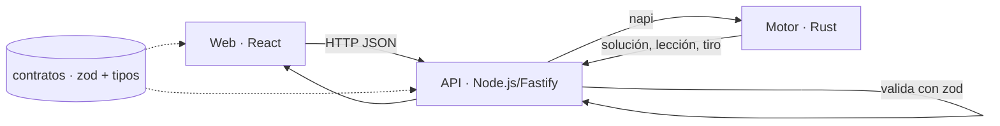

# CinemaLab 2.0

**Cinemática paso a paso: resolvé, entendé y jugá.** Proyecto de Mecánica Clásica (MEC115).

- **Resolvedor**: MRU, MRUA y tiro parabólico. Escribís los datos del enunciado y el programa elige la ecuación, despeja, sustituye y te da el resultado paso a paso. Después anima el movimiento y te muestra las gráficas.
- **Modo clase**: una explicación por escenas, como una presentación, con la animación sincronizada, las fórmulas y **narración por voz**. Explica la teoría y después *tu propio ejercicio*.
- **La hondilla** (tiro parabólico), con escenarios de El Salvador:
  - *Botá las latas*: 5 niveles (la cancha de la colonia, el parque de Juayúa, el muro de la escuela, la azotea de la tienda, el cerro de Apaneca).
  - *Bajá mangos*: le tirás piedritas al palo de mango; cuando le das, el mango cae en **caída libre**.
  - *Hondillazos entre amigos*: 2 jugadores por turnos.
  - Después de cada tiro: análisis de la trayectoria y deducción del **tiro perfecto**. Con **Rayos X** ves la sombra de la piedra en cada eje (MRU en x, MRUA en y).

## Arquitectura

```
cinemalab/                       monorepo (pnpm workspaces + cargo workspace)
├── crates/
│   ├── fisica-core/             Motor en Rust: dominio puro, sin dependencias de Node
│   │   ├── src/modelos/         MRU, MRUA y parabólico: variables, ecuaciones y despejes (LaTeX)
│   │   ├── src/solver.rs        Resolución paso a paso + verificación de consistencia
│   │   ├── src/movimiento.rs    Simulación (todos son movimientos con aceleración constante)
│   │   ├── src/leccion.rs       Guiones del Modo clase
│   │   ├── src/juego/           Escenarios, física del tiro, análisis y tiro perfecto
│   │   ├── src/api.rs           Funciones JSON → JSON (única puerta de entrada)
│   │   └── tests/               Pruebas de validación (cargo test)
│   └── fisica-node/             Puente nativo Rust → Node.js (napi)
├── apps/
│   ├── api/                     Node.js + Fastify + TypeScript: API REST, validación con zod
│   └── web/                     React + TypeScript + Vite: interfaz, lienzos y juego
│       └── src/demo/            Copia del motor en TypeScript, solo para el HTML de demostración
├── packages/
│   └── contratos/               Esquemas zod y tipos compartidos por la API y la web
└── scripts/compilar-nativo.mjs  Compila el motor y genera fisica.node
```



**Principios:**

1. **Toda la física vive en Rust.** La web no evalúa ecuaciones: dibuja e interpola las muestras que calcula el motor.
2. **Contratos explícitos.** Las entradas se validan con zod en la API y con serde en Rust. Las salidas tienen tipos compartidos en `@cinemalab/contratos`.
3. **Capas independientes y probables.** El motor se prueba sin Node (`cargo test`), la API sin abrir puertos (`app.inject`) y la web con Vitest.

## Requisitos

- [Rust](https://rustup.rs) (stable). En Windows también hacen falta las *Build Tools* de Visual Studio, que rustup ofrece instalar.
- [Node.js](https://nodejs.org) 20 o más reciente.
- pnpm: `corepack enable` (viene con Node) o `npm i -g pnpm`.

## Comandos

```bash
pnpm install          # dependencias de Node
pnpm dev              # compila el motor y levanta API (3000) + web (5173)
pnpm test             # cargo test + pruebas de la API y de la web
pnpm build            # compila motor, web y API para producción
pnpm start            # sirve todo en http://localhost:3000
```

En desarrollo abrí **http://localhost:5173**. Vite manda las llamadas `/api` a la API.

### HTML de demostración (sin servidor)

```bash
pnpm build:demo       # genera apps/web/dist-demo/index.html
```

Genera **un solo archivo HTML** que se abre con doble clic, sin instalar nada. Para la demo, el motor está copiado en TypeScript (`apps/web/src/demo`). El motor oficial sigue siendo el de Rust: las **pruebas de paridad** (`apps/web/test/paridad.test.ts`) comparan las dos versiones en ejercicios, lecciones, tiros y sugerencias de todos los escenarios, y deben dar exactamente lo mismo.

## API

| Método | Ruta | Descripción |
|---|---|---|
| GET | `/api/salud` | Estado y versión del motor |
| GET | `/api/modelos` | Modelos con variables, ecuaciones y ejemplos |
| POST | `/api/resolver` | `{ modelo, datos, incognitas }` → pasos + simulación |
| POST | `/api/leccion` | `{ modelo, datos?, incognitas?, enunciado? }` → guion del Modo clase |
| GET | `/api/juego/escenarios` | Escenarios del juego |
| POST | `/api/juego/tiro` | `{ escenario, jugador, angulo, rapidez, activos }` → trayectoria, impactos y análisis |
| POST | `/api/juego/sugerencia` | `{ escenario, jugador, angulo, activos }` → tiro perfecto paso a paso |

Ejemplo:

```bash
curl -X POST localhost:3000/api/resolver -H 'content-type: application/json' \
  -d '{"modelo":"mrua","datos":{"v0":25,"v":0,"dx":50},"incognitas":["a","t"]}'
```

## Publicar en Internet

La app necesita un servidor, porque la API corre en Node.js con el motor nativo. Con el `Dockerfile` incluido:

- **Render**: crear un *Web Service* desde el repositorio. Render detecta `render.yaml` y el Dockerfile.
- **Railway / Fly.io / un VPS**: `docker build -t cinemalab . && docker run -p 3000:3000 cinemalab`.

## Convenciones físicas

Unidades del SI · eje y positivo hacia arriba · g = 9.81 m/s² · sin resistencia del aire · ángulos en grados.
